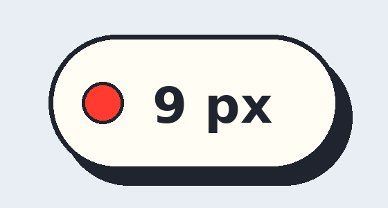

# FreezeMark · 屏幕冻结标注


同时按下 **Enter + Backspace**，整个屏幕立刻冻结成一张静态图，你可以在上面随手画框标注；右键或 Esc 退出，一切恢复如初，标注不保存、不留痕。

顶部中央是一颗手绘纸面风的胶囊：色点 + 当前线宽。点开是灵动岛式形变展开的工具面板（矩形 / 圆角矩形 / 圆形、实线 / 虚线、8 色、撤回 / 清空），展开时还有内容的交叉淡化动画。



## 操作速查

| 操作 | 效果 |
|---|---|
| Enter + Backspace | 冻结 / 退出冻结 |
| 左键拖动 | 画标注框 |
| 鼠标滚轮 | 调线条粗细 1–20 px（拖框途中滚也实时生效） |
| 鼠标中键 | 循环切换线条颜色（红→橙→黄→绿→蓝→紫→黑→白） |
| 左键按下期间 | 胶囊自动收回并渐隐，松开渐显回来，不挡标注 |
| 右键 / Esc | 退出冻结（标注随即丢弃，不保存） |
| 单击胶囊 | 展开 / 收起工具面板 |
| 托盘右键 | 开机自启动开关、退出程序 |

完整说明见 [docs/使用说明.md](docs/使用说明.md)。

## 下载

到 [Releases](https://github.com/yangjike22/FreezeMark/releases) 下载 `FreezeMark.exe`，双击即可运行（托盘常驻，默认开机自启，可在托盘菜单关掉）。

> 首次运行若弹出 Windows SmartScreen「无法识别的应用」，点「仍要运行」即可：这是因为程序没有购买代码签名证书、且文件较新，并非查出病毒。程序本身不含任何网络代码（见下）。

## 隐私与安全

- **完全离线**：二进制导入表中没有任何网络 DLL（无 WS2_32 / WININET / WINHTTP / URLMON），结构上发不出网络请求
- **不保存**：冻结截图只在内存中，画的标注从不落盘；唯一的本地文件是 exe 旁的诊断日志 `freezemark_debug.log`
- **行为可审计**：源码就一个 `main.cpp`；敏感 API 各有出处——键盘钩子只为检测 Enter+Backspace 组合键，注册表只写开机自启一项，进程结束只针对它自己的旧版本（新版接管旧版用）

## 构建

源码是单个 Win32 + GDI+ 程序，在 Linux 上用 MinGW 交叉编译：

```sh
sh build.sh   # 生成图标 → 编资源 → x86_64-w64-mingw32-g++ 静态链接
```

产物 `FreezeMark.exe`，只依赖 Windows 系统 DLL 与 gdiplus。

## 许可证

[MIT](LICENSE)
